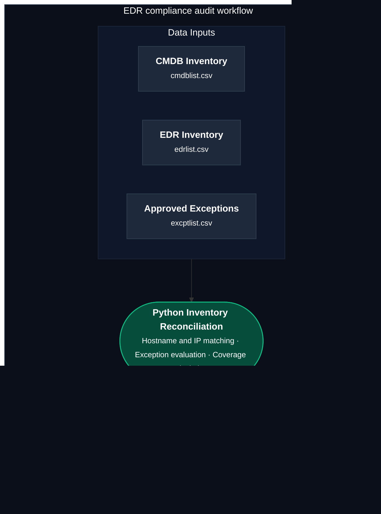

# **EDR Deployment Coverage & Compliance Audit Automation**
## **Overview**
This project is a Python proof of concept (POC) demonstrating how security teams can automate Endpoint Detection and Response (EDR) deployment coverage audits by reconciling endpoint inventory data from a mock Configuration Management Database (CMDB), EDR platform inventory, and a known exception list.

The script compares endpoint records across all three datasets to identify systems that are registered in the CMDB but do not have an EDR agent deployed or an approved exception.

The automation generates a CSV report containing endpoints identified as missing EDR coverage, while also calculating overall EDR deployment coverage and exception percentages.

**The goal:** Reduce manual effort in validating endpoint security coverage and provide security teams with actionable visibility into potential EDR deployment gaps.
## **Business Problem**
Security teams need visibility into whether endpoints across their environment have the required security tooling deployed.

Manually comparing CMDB exports against EDR inventory reports and approved exception lists can be time-consuming, especially as endpoint inventories grow.

This creates several challenges:

- Identifying endpoints registered in the CMDB but missing from the EDR platform.

- Accounting for unsupported operating systems or other approved EDR deployment exceptions.

- Measuring EDR deployment coverage across the environment.

- Producing actionable reports that infrastructure and security teams can use to investigate deployment gaps.

This POC automates that reconciliation process using Python and CSV files.
## **How It Works**
The script uses three inventory sources:

| **Input File** | **Description** |
| :---: | :---: |
| `cmdblist.csv` | Mock CMDB inventory containing endpoint hostnames, IP addresses, and domains. |
| `edrlist.csv` | Mock EDR inventory containing endpoints with an EDR agent deployed. |
| `excptlist.csv` | Known exception inventory containing endpoints excluded from EDR deployment requirements. |

### **Audit Workflow**
1. **Import CMDB Inventory:** Read the CMDB CSV and build a dictionary of endpoint hostnames and IP addresses.

2. **Import EDR Inventory:** Read the EDR CSV and build a dictionary of endpoints reporting to the EDR platform.

3. **Import Exception List:** Read the exception CSV and build a dictionary of endpoints approved for exclusion.

4. **Reconcile Inventory:** Compare CMDB endpoints against the EDR inventory using both hostname and IP address matching.

5. **Evaluate Exceptions:** Identify endpoints on the approved exception list and exclude them from missing EDR findings.

6. **Calculate Compliance:** Calculate EDR deployment coverage, exception percentages, and missing deployment percentages.

7. **Generate Report:** Export endpoints identified as missing EDR coverage into `missedrlist.csv`.
## **Project Structure**
text

`EDR-Compliance-Audit/` `│` `├── EDR_Compliance.py    # Main Python automation script` `│` `├── cmdblist.csv         # Mock CMDB endpoint inventory` `├── edrlist.csv          # Mock EDR agent inventory` `├── excptlist.csv        # Mock approved exception inventory` `│` `└── missedrlist.csv      # Generated report of endpoints missing EDR` 
## **Requirements**
- Python 3.x

- Python standard library (`csv` module)

No third-party Python packages are required.
## **Usage**
1. Clone this repository:

bash

` git clone  `[https://github.com/YOUR-USERNAME/EDR-Compliance-Audit.git](https://github.com/YOUR-USERNAME/EDR-Compliance-Audit.git)``

1. Navigate into the project directory:

bash

`cd EDR-Compliance-Audit` 

1. Ensure the three input CSV files are present in the same directory as the Python script.

2. Execute the script:

bash

`python EDR_Compliance.py` 

1. Review the console output for EDR deployment coverage metrics.

2. Review the generated `missedrlist.csv` file for endpoints identified as missing EDR coverage.
## **Sample Data**
The repository includes mock inventory data to demonstrate the reconciliation process.
### **CMDB Inventory (**`cmdblist.csv`**)**
Contains seven endpoint records.
### **EDR Inventory (**`edrlist.csv`**)**
Contains three endpoints reporting to the EDR platform.
### **Exception Inventory (**`excptlist.csv`**)**
Contains one endpoint with an approved EDR deployment exception.
## **Example Results**
Using the provided sample datasets, the script produces the following results:

| **Metric** | **Result** |
| :---: | :---: |
| Total CMDB endpoints | 7 |
| Endpoints found in EDR | 3 |
| Approved exceptions | 1 |
| Endpoints missing EDR | 3 |
| EDR deployment coverage | 42.86% |
| Exception percentage | 14.29% |
| Missing EDR percentage | 42.86% |
### **Generated Report:** `missedrlist.csv`
The script generates a CSV containing the endpoints identified as missing EDR coverage.

Example:

csv

`workstation4,10.3.5.29` `workstation5,10.3.5.30` `workstation6,10.3.5.31` 

This report provides a starting point for security and infrastructure teams to investigate potential EDR deployment gaps.
## **Key Skills Demonstrated**
This proof of concept demonstrates several practical security automation and data analysis concepts:

- **Python Automation:** Using Python to automate repetitive security auditing tasks.

- **CSV Data Processing:** Reading, parsing, and processing inventory exports.

- **Asset Reconciliation:** Comparing endpoint inventories across multiple data sources.

- **Exception Management:** Accounting for approved exclusions when evaluating security control coverage.

- **Security Compliance Reporting:** Calculating deployment coverage and identifying potential compliance gaps.

- **Report Generation:** Producing actionable CSV output for further investigation and remediation.
## **Limitations & Future Improvements**
This is an initial proof of concept built around static CSV exports and mock inventory data.

Potential future enhancements include:

- Integrating directly with CMDB and EDR platform APIs instead of relying on manual CSV exports.

- Improving hostname normalization to account for naming inconsistencies.

- Adding duplicate asset detection and more robust IP address reconciliation.

- Validating approved exceptions against expiration dates and exception status.

- Generating timestamped audit reports.

- Adding automated HTML or Excel reporting with visual compliance metrics.

- Implementing logging, error handling, and input validation.

- Scheduling recurring audits to monitor EDR deployment coverage over time.
## **Disclaimer**
This project is a proof of concept intended for educational and demonstration purposes.

All inventory data included in this repository is mock data. The script is not intended to represent a production-ready EDR compliance auditing solution.

